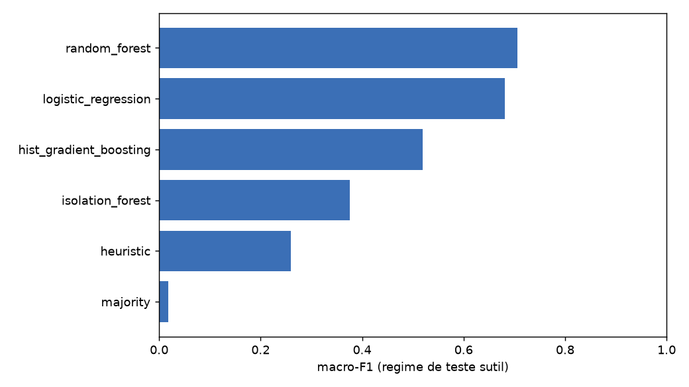
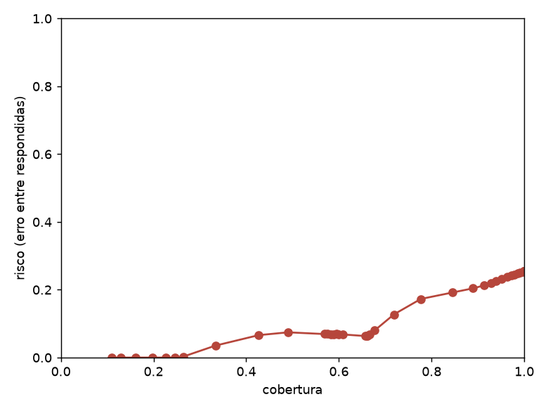

# Relatório — agente de anomalias NetSpot

## Manifesto
```json
{
  "git_commit": "4c6c1d0",
  "generated_at": "20261018T120635Z",
  "seed": 0,
  "n_per_class": 500,
  "n_boot": 1000,
  "package_versions": {
    "numpy": "2.5.1",
    "scipy": "1.18.0",
    "sklearn": "1.9.0",
    "pandas": "3.0.5",
    "matplotlib": "3.11.1",
    "torch": "2.14.1",
    "transformers": "5.20.1"
  },
  "config_hashes": {
    "baseline:heuristic": "e27f3e69f61f4fb5",
    "baseline:random_forest": "a876516dd542ba91"
  },
  "dataset_hashes": {
    "train": "9b252753460df9a4ac59144ca49fbf3f",
    "val": "f8ca1bc5a9743f901929aba847341205",
    "test": "8f65562979eef3b6cd27e78f781fae59"
  },
  "engines": {
    "heuristic": "heuristic",
    "majority": "majority",
    "random_forest": "random_forest",
    "hist_gradient_boosting": "hist_gradient_boosting",
    "logistic_regression": "logistic_regression",
    "isolation_forest": "isolation_forest"
  },
  "metric_hashes": {
    "heuristic": "e0bc5249229079437af9967fdf430e4dba5122475f2b810eca9ee0d82bf5adc0",
    "majority": "9b80a83f83dc97d5c796438f1a01493328fa8ea7a00ebbf8f64ee42efa4fc973",
    "random_forest": "7cda1a8d215b54788312dbb11ff14ab054cad0cca30857788415f1d107728909",
    "hist_gradient_boosting": "2d503840fdd7f054ffed1379004dfa8b252c271dd5eb5e30afb7ec1651bef3e7",
    "logistic_regression": "ca9aca5d42a37dc13fa5ec48bc1beaca248763e705742712bf6547fa14fa0814",
    "isolation_forest": "4192ca14dc91faf560945038ed8543d1ca6496240c3fb81ea51996172a4ab45b"
  },
  "baseline_macro_f1": {
    "heuristic": 0.26015,
    "majority": 0.018182,
    "random_forest": 0.706228,
    "hist_gradient_boosting": 0.518799,
    "logistic_regression": 0.681121,
    "isolation_forest": 0.376405
  }
}
```

## Baselines
| Motor | macro-F1 | IC95 | acurácia | balanceada |
|---|---|---|---|---|
| random_forest | 0.706 | [0.694, 0.718] | 0.730 | 0.730 |
| logistic_regression | 0.681 | [0.669, 0.692] | 0.660 | 0.660 |
| hist_gradient_boosting | 0.519 | [0.509, 0.528] | 0.623 | 0.623 |
| isolation_forest | 0.376 | [0.364, 0.389] | 0.402 | 0.668 |
| heuristic | 0.260 | [0.254, 0.266] | 0.366 | 0.366 |
| majority | 0.018 | [0.017, 0.020] | 0.100 | 0.100 |



## Agente LLM (zero-shot)
- modelo: `Qwen/Qwen2.5-1.5B-Instruct` (zero_shot)
- JSON válido: 0.960
- macro-F1: 0.145 (IC 0.113-0.175)
- latência/amostra: 9.36 s

## Ablação RAG
- k=3: sem RAG 0.167 vs com RAG 0.087; McNemar p=0.015625; precisão retrieval 0.680

## Decisão e abstenção
```json
{
  "per_engine": [
    {
      "engine": "random_forest",
      "ece_before": 0.12210750000000004,
      "ece_after": 0.002175414867692771,
      "temperature": 0.11344314637730009
    },
    {
      "engine": "hist_gradient_boosting",
      "ece_before": 0.03884557850246055,
      "ece_after": 0.03480090339345001,
      "temperature": 1.3852741000921267
    },
    {
      "engine": "logistic_regression",
      "ece_before": 0.08846905307469895,
      "ece_after": 0.08773128743342402,
      "temperature": 1.063671649140901
    }
  ],
  "ensemble": {
    "ece": 0.165413453228807,
    "weights": [
      0.43527358930798116,
      0.35090787190207684,
      0.213818538789942
    ]
  },
  "target_coverage": 0.7,
  "chosen_threshold": 0.8200528785811814,
  "test_coverage": 0.427,
  "test_risk_at_threshold": 0.0661592505854801,
  "test_abstain_rate": 0.573
}
```



## Explicabilidade
- COMBINED_FAULT: rubrica 1.47, aderência de evidência 0.07
- DATA_EXFILTRATION: rubrica 2.40, aderência de evidência 1.00
- DDOS_ATTACK: rubrica 2.00, aderência de evidência 0.00
- DISK_EXHAUSTION: rubrica 2.27, aderência de evidência 1.00
- HOST_DOWN: rubrica 1.87, aderência de evidência 0.07
- MEMORY_LEAK: rubrica 2.67, aderência de evidência 1.00
- NETWORK_CONGESTION: rubrica 2.00, aderência de evidência 0.00
- NORMAL: rubrica 2.53, aderência de evidência 1.00
- PORT_SCAN: rubrica 2.13, aderência de evidência 0.27
- SERVICE_OUTAGE: rubrica 1.93, aderência de evidência 0.73

## Ameaças à validade
- Simulador único é circular: o holdout externo (Kathará/datasets públicos) ainda não foi executado; resultados refletem o simulador.
- O teste sutil (severidade 0.25-0.40) é um regime não visto no treino; modelos clássicos saturam no regime fácil, não aqui.
- Medições do LLM usam um proxy pequeno (1.5B) no Mac; o alvo 7B roda em Linux/GPU e ainda não tem número.
- PEFT está implementado e testado, mas o treino/comparativo real pendem de GPU; H1/H2 ainda sem número.
