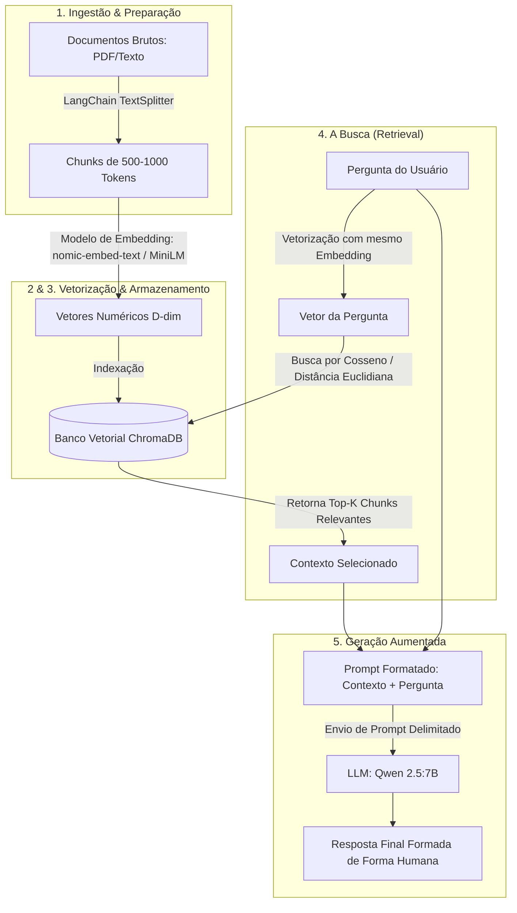

# Como Funciona a Arquitetura RAG na Prática

Este repositório contém uma demonstração completa e prática da arquitetura **RAG (Retrieval-Augmented Generation)** utilizando **ChromaDB**, **LangChain**, e o modelo **Qwen 2.5:7B** (via Ollama local).

---

## 🏗️ As 5 Etapas do RAG na Prática



---

## 📁 Conteúdo do Repositório

- 🐍 **`rag_pipeline.py`**: Script Python autocontido que conecta LangChain, ChromaDB e Ollama local para executar todo o fluxo no terminal.
- 📋 **`requirements.txt`**: Requisitos do projeto Python (`chromadb`, `langchain-text-splitters`, `ollama`, `sentence-transformers`).
- 🌐 **`index.html` & `src/`**: Aplicação Web Interativa (RAG Playground) para visualizar interativamente cada uma das 5 etapas do RAG.

---

## 🚀 Como Executar o Script Python

### 1. Instalar as Dependências

```bash
pip install -r requirements.txt
```

### 2. (Opcional) Iniciar o Ollama com Qwen 2.5:7B

Caso deseje rodar a geração real com o LLM localmente:

```bash
# Baixar e rodar o Qwen 2.5 7B
ollama run qwen2.5:7b
```

### 3. Executar o Pipeline RAG

```bash
python rag_pipeline.py "Como funciona a nova política de férias e o fracionamento?"
```

---

## 💻 Como Executar o Visualizador Web Interativo

Para abrir o painel gráfico interativo no navegador:

```bash
# Opção 1: Usando Python HTTP Server
python3 -m http.server 8080

# Opção 2: Usando Npx Serve ou Live Server
npx serve .
```

Abra o seu navegador em `http://localhost:8080` para visualizar os chunks, os vetores do ChromaDB, a busca por similaridade e a geração do Qwen 2.5:7B!
