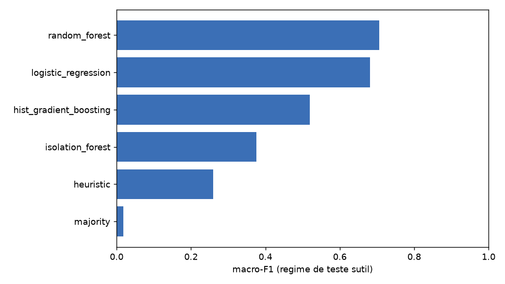
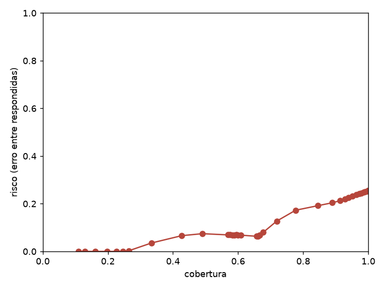

# NetSpot: monitoração de rede com classificação de anomalias


NetSpot é um NOC Lite, isto é, um centro de operações de rede de escopo reduzido para laboratórios e infraestruturas pequenas. Ele monitora hosts e ativos por ICMP, TCP, HTTP/HTTPS, DNS e SNMP, mostra o estado em painéis web, mantém o histórico de incidentes e envia alertas.

O repositório também contém o trabalho experimental em torno do classificador de anomalias do sistema: simulador de falhas, conjuntos de dados sem vazamento, baselines clássicos, agente de linguagem com saída estruturada, memória de perfis históricos, calibração de confiança, explicabilidade e mitigação em laboratório. Os experimentos são reprodutíveis e os resultados ficam registrados em `Backend/harness/results/`.

## Arquitetura

```text
Navegador
  ├── HTTP :8080  Frontend (Nginx): painel, simulador e histórico de incidentes
  └── HTTP :8000  Backend (FastAPI): API REST e documentação Swagger

Backend (FastAPI)
  ├── PostgreSQL 15: hosts, métricas, incidentes e usuários
  ├── ICMP, TCP, HTTP/HTTPS e DNS: hosts monitorados
  ├── SNMP (UDP :161): agentes nativos em Windows e Linux
  └── RabbitMQ (AMQP): filas internas; alertas por Telegram e webhook para o N8N
```

## Monitoração

- ICMP: latência em milissegundos e perda de pacotes.
- TCP: verificação de porta aberta ou fechada.
- HTTP/HTTPS: código de status e tempo de resposta.
- DNS: validação da resolução de nomes.
- SNMP multivendor: CPU, memória, disco e tráfego de entrada e saída, com mapeamento automático para Linux (UCD-SNMP) e Windows (HOST-RESOURCES-MIB).
- Saúde dos ativos e SLA: pontuação de saúde por host, jitter e tendências.
- Alertas por Telegram, com antispam, e webhook para automações no N8N.
- Retenção do histórico configurável em `NETSPOT_RETENTION_DAYS`, com padrão de 30 dias. O valor 0 desliga a limpeza.

## Simulador e classificação de anomalias

O simulador gera telemetria para 11 cenários: operação normal, ataque DDoS volumétrico, varredura de portas, host inacessível, vazamento de memória, exfiltração de dados, esgotamento de disco, falha de aplicação, falha combinada, congestionamento de rede e modo personalizado. No painel do simulador, os valores de CPU, RAM, disco, latência, perda, jitter, banda, conexões e código HTTP são ajustados com controle deslizante.

O classificador combina três motores:

1. Regras heurísticas de NOC, com limiares por métrica.
2. Aprendizado de máquina, com Isolation Forest para detecção de anomalia e Random Forest para classificação.
3. Geração de texto local com Ollama, usando recuperação de casos no dataset `netspot_anomaly_dataset.csv` via ChromaDB.

A resposta final traz o cenário provável, a severidade, as evidências, a causa provável, o impacto e um playbook de mitigação.

## Artigo: detecção e mitigação de anomalias de rede com LLMs open source

O NOC Lite monitora hosts por ICMP, TCP, HTTP/DNS e SNMP e classifica uma amostra de telemetria em um dos dez cenários, com justificativa e plano de mitigação. O protótipo original media a si mesmo: treino e teste saíam do mesmo simulador, o motor generativo lia o rótulo e o índice de recuperação guardava o nome do cenário. O trabalho reconstrói a avaliação para medir generalização sobre dados não vistos. A camada de pesquisa fica em `Backend/harness/` e `Backend/services/agent/`.

### Objetivos

Quatro perguntas guiam o trabalho:

1. Um modelo de linguagem open source é competitivo com métodos clássicos em dados que ele não viu no treino?
2. O ajuste fino com LoRA e QLoRA melhora sobre a versão sem treino, e em quanto?
3. A memória de casos agrega robustez sem vazar o rótulo do cenário?
4. As saídas são calibradas, auditáveis e as justificativas fiéis à telemetria?

### Metodologia

**Dados e divisões.** O simulador gera telemetria para os dez cenários com faixas de severidade separadas entre treino, validação e teste, de modo que os conjuntos não compartilhem a faixa do gerador. O treino usa anomalias claras e o teste usa anomalias sutis, o que mede generalização em vez de memorização. O CSV real entra por divisão temporal. UNSW-NB15 e CSE-CIC-IDS2018 entram como holdout externo, e os cenários do Kathará servem de laboratório emulado. Um teste automático falha se o rótulo aparecer na entrada, na consulta de recuperação ou no índice.

**Motores comparados.** No mesmo conjunto rodam heurística de NOC, Random Forest, gradient boosting, regressão logística, Isolation Forest, agente de linguagem sem e com exemplos, memória de casos, ajuste fino LoRA/QLoRA e combinação calibrada com abstenção. Nenhum resultado de modelo de linguagem é reportado sem o baseline clássico no mesmo split.

**Métricas e estatística.** macro-F1, acurácia balanceada, precisão e recall por classe, matriz de confusão, PR-AUC, erro de calibração esperado, curvas de cobertura e risco, latência por amostra e taxa de JSON inválido. Toda métrica vem com intervalo de confiança bootstrap de 95%, e a comparação entre motores usa McNemar com correção de Holm-Bonferroni.

**Mitigação em ciclo fechado.** O agente escolhe ações de um catálogo fechado, simula antes de aplicar, mede o efeito na vítima, reverte quando não há melhora e registra a trajetória com hash. A saída passa por schema estrito com retentativa, conferência das evidências contra a telemetria e veredito independente que barra ações fora do catálogo.

**Reprodutibilidade.** Seed fixa, configuração versionada e resultado com hash: duas execuções da mesma configuração produzem o mesmo resultado. O laboratório usa Kathará com bridge Ethernet nativa, moldagem de tráfego com tc e filtro de camada 2 com ebtables.

### Resultados e discussão

No conjunto interno de teste, com 500 amostras por classe e mil reamostragens bootstrap, o Random Forest obteve macro-F1 de 0,706, com intervalo de 0,694 a 0,718, e acurácia de 0,730. A regressão logística veio logo atrás, com 0,681. Depois vieram o gradient boosting, com 0,519, o Isolation Forest, com 0,376, e a heurística de NOC, com 0,260. Apostar sempre na classe mais frequente rende 0,018, o que mostra que as doze métricas carregam sinal de verdade. A distância curta entre os dois melhores sugere que o problema se resolve com relações simples entre as variáveis.

O agente de linguagem, rodado com um modelo de 1,5 bilhão de parâmetros como aproximação do alvo de 7 bilhões, marcou 0,145 de macro-F1, com intervalo de 0,113 a 0,175, e 0,287 de acurácia. Devolveu JSON válido em 96% das respostas e gastou 9,4 segundos por amostra. Os erros se concentram em poucas classes, porque o modelo repete um rótulo provável em vez de separar os dez cenários. A memória de casos, com precisão de recuperação de 0,68, não ajudou: o macro-F1 caiu de 0,167 para 0,087 e o teste de McNemar deu p igual a 0,016. Esse número vale para o modelo pequeno, e só a medição com o modelo grande vai dizer se a memória ajuda.



Na calibração, o ajuste de temperatura levou o erro de calibração esperado do Random Forest de 0,122 para 0,002. O conjunto com abstenção operou com cobertura de 0,427 no teste e risco de 0,066, abaixo da meta, deixando 57,3% das amostras sem resposta quando a confiança era baixa. A explicabilidade foi irregular. Para exfiltração, esgotamento de disco, vazamento de memória e operação normal, as evidências apontadas bateram com a telemetria em 100% dos casos; para ataque DDoS e congestionamento de rede, em nenhum.

No laboratório emulado com Docker e Kathará, o agente reduziu um ataque DDoS de 4,14 Mbps para 1,00 Mbps e zerou a exfiltração, que saiu de 137,7 Mbps. Das dez anomalias testadas, duas tiveram mitigação confirmada, quatro foram revertidas porque a medição não mostrou melhora, três ficaram sem verificação por não haver métrica de referência e uma não exigia ação.



### Conclusão

O ciclo fechado é o resultado mais sólido. O agente escolhe uma ação, aplica, mede o efeito e reverte quando não há ganho, e isso foi comprovado em laboratório real. A detecção clássica ainda ganha do modelo de linguagem pequeno, que erra por falta de variedade nas respostas e é lento. O sistema está implementado e coberto por testes, mas falta a evidência com o modelo de 7 bilhões e com os adaptadores LoRA/QLoRA treinados, o que depende de uma máquina Linux com GPU. Até lá, os números do agente são os do proxy.

### Trabalhos futuros

Rodar o modelo de 7 bilhões no Linux com GPU e repetir as medições para saber se a memória de casos passa a ajudar. Treinar os adaptadores LoRA/QLoRA e comparar com a versão sem treino. Executar por inteiro os conjuntos externos UNSW-NB15 e CSE-CIC-IDS2018, cujo carregador já está pronto. Ampliar os cenários do laboratório, que hoje cobrem congestionamento, host inacessível e exfiltração mas não falhas de enlace. Também está em aberto trocar a ponte Ethernet por um controlador SDN com OpenFlow.

### Reprodução

Comandos:

```bash
make test            # suíte dos experimentos (121 testes)
make repro           # baselines completos, manifesto e relatório
make repro-anomaly   # 10 anomalias no laboratório Kathará (requer Docker e Kathará)
make repro-report    # gera o relatório HTML
```

As saídas ficam em `Backend/harness/results/`: `report.md`, `report.html` e os artefatos por execução.

Os números do agente de linguagem usam um modelo local pequeno, o Qwen2.5-1.5B-Instruct, como aproximação. O modelo alvo, de 7 bilhões de parâmetros, e o treino dos adaptadores LoRA/QLoRA rodam em Linux com GPU; o caminho está implementado e coberto por testes, e o relatório marca o que ainda depende desses recursos. As ameaças à validade estão listadas no próprio relatório.

## Estrutura de diretórios

```text
NetSpot/
├── Backend/
│   ├── harness/                    # Experimentos: configurações, divisões, métricas, estatística, Kathará
│   ├── services/
│   │   ├── agent/                  # Agente: telemetria, memória, decisão, plano, verificação, XAI
│   │   ├── anomaly_classifier.py   # Classificador de anomalias
│   │   ├── anomaly_simulator.py    # Simulador de cenários
│   │   └── retention_service.py    # Limpeza do histórico
│   ├── routes/                     # Endpoints REST
│   ├── snmp/                       # Coleta SNMP multivendor
│   ├── tests/                      # Testes da API
│   ├── main.py                     # Aplicação FastAPI
│   ├── scheduler.py                # Agendamento das checagens
│   └── snmp_engine.py              # Motor de coleta SNMP
├── Frontend/                       # Painel web servido por Nginx
├── RAG/                            # Playground do RAG com ChromaDB e LangChain
├── scripts/                        # Avaliações, relatório e agentes SNMP
├── N8N/                            # Workflows de alerta
├── netspot_anomaly_dataset.csv     # Dados de anomalias do classificador e do RAG
├── Makefile                        # Comandos de teste e reprodução
└── docker-compose.yml              # Orquestração dos cinco serviços
```

## Como executar

Pré-requisitos: Docker e Docker Compose v2.

```bash
cp .env.example .env
docker compose up -d --build
```

Cinco serviços sobem: PostgreSQL, backend, frontend, RabbitMQ e N8N. Antes de subir, edite o `.env`. `NETSPOT_SECRET_KEY` assina os tokens de sessão e `NETSPOT_DEFAULT_ADMIN_PASSWORD` define a senha do usuário `admin` criado na primeira subida. Sem a primeira, o login falha; sem a segunda, o usuário nem é criado. Os dados do Telegram são opcionais.

`docker compose ps` mostra o estado dos containers, `docker compose logs -f backend` acompanha os logs e `docker compose down` derruba tudo. As tabelas do banco são criadas na primeira subida, sem passo de migração.

## Endereços de acesso

| Serviço | Endereço |
|:--|:--|
| Painel e login | http://localhost:8080 |
| Simulador de anomalias | http://localhost:8080/simulator.html |
| Histórico de incidentes | http://localhost:8080/incidents.html |
| API e Swagger | http://localhost:8000/docs |
| RabbitMQ Management | http://localhost:15672 |
| N8N | http://localhost:5678 |
| RAG Playground | http://localhost:8085 |

O RAG Playground é servido fora do Docker, com `python3 -m http.server 8085 --directory RAG`.

## Demonstração

Roteiro para mostrar o sistema no ar, do login aos experimentos.

1. Suba o sistema como na seção anterior e confirme que os cinco containers estão de pé com `docker compose ps`.
2. Abra http://localhost:8080. A página inicial redireciona para o login. Entre com `admin` e a senha de `NETSPOT_DEFAULT_ADMIN_PASSWORD`; o primeiro acesso exige a troca de senha.
3. Abra o simulador em http://localhost:8080/simulator.html. Clique em um dos dez cenários para gerar a amostra de métricas e ver o diagnóstico dos três motores, heurística, Machine Learning e IA generativa com RAG. O botão Benchmark roda os dez cenários e compara a acurácia de cada motor. O texto do terceiro motor melhora com o Ollama descrito abaixo; sem ele, o sistema cai no motor offline e a demonstração segue igual.
4. No painel, cadastre um host em "Cadastrar Host" com Nome, Endereço/IP e, se quiser, URL HTTP e portas TCP, e clique em checar. O histórico de métricas, a saúde do ativo, o SLA e os alertas aparecem no painel. A "Descoberta de Rede" varre uma sub-rede por CIDR. Para um teste rápido dentro do Docker, use o endereço `frontend` na porta 80; para um alvo no host, use `host.docker.internal`.
5. Em http://localhost:8080/incidents.html está o histórico completo de incidentes, com filtros por período, host e tipo.
6. A documentação interativa da API está em http://localhost:8000/docs. Os endpoints do classificador ficam em `/anomalies`: `/simulate` gera uma amostra, `/classify` roda a classificação, `/benchmark` compara os motores e `/genai/status` mostra se o Ollama está acessível.
7. O RAG Playground é servido fora do Docker, com `python3 -m http.server 8085 --directory RAG`, em http://localhost:8085.
8. Os experimentos rodam no host, com o ambiente Python do projeto: `make test` executa a suíte, `make repro` gera baselines, manifesto e relatório, `make repro-report` regera o HTML e `make repro-anomaly` roda as dez anomalias no laboratório Kathará, que precisa de Docker e Kathará.

### Ollama (opcional)

O terceiro motor do classificador usa um modelo local. Instale o Ollama no host e baixe um dos modelos aceitos:

```bash
ollama pull qwen2.5:7b
```

Os modelos aceitos, em ordem de preferência, são `qwen2.5:7b`, `llama3.1:8b`, `gemma2:9b` e `gemma:2b`. O backend acessa o Ollama do host em `host.docker.internal:11434`, e a disponibilidade aparece em `/anomalies/genai/status`.

## Testes

```bash
# suíte dos experimentos, no host com o ambiente Python do projeto
make test

# suíte da API, com os containers no ar
docker exec -e PYTHONPATH=. netspot-backend python -m pytest Backend/tests -q
```

A suíte dos experimentos tem 121 testes. Quatro testes de integração com o Kathará ficam ignorados sem Docker, e um teste de ajuste fino fica ignorado quando a biblioteca opcional `peft` não está instalada.

## Tecnologias

- Backend: Python 3.11, FastAPI, SQLAlchemy, AsyncPG, PySNMP, Pydantic e Uvicorn.
- Frontend: HTML, CSS e JavaScript, com Chart.js e Nginx.
- Classificação: scikit-learn, ChromaDB, LangChain e Ollama.
- Experimentos: numpy, scipy, scikit-learn e matplotlib; PyTorch, transformers e peft no agente de linguagem; Kathará no laboratório.
- Dados e mensageria: PostgreSQL 15, RabbitMQ e N8N.
- Infraestrutura: Docker e Docker Compose.

## Licença

O código é distribuído sob a licença MIT. Uso, modificação e redistribuição são permitidos, com a atribuição da licença.
